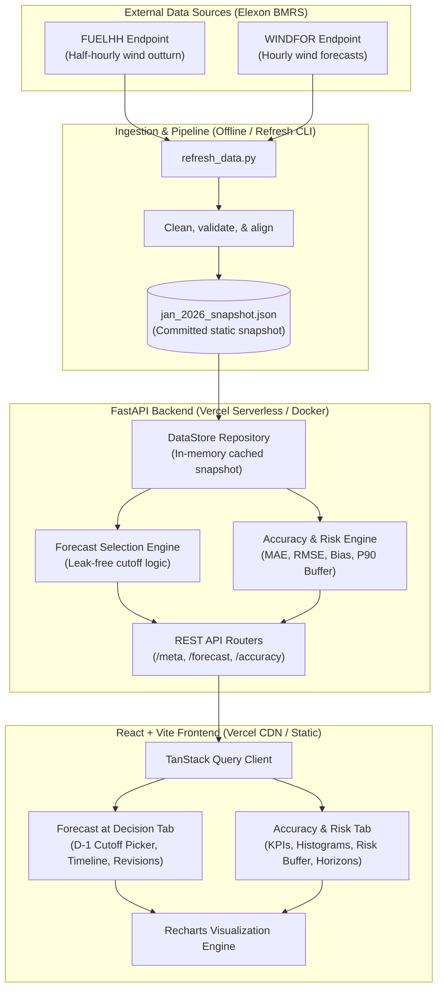
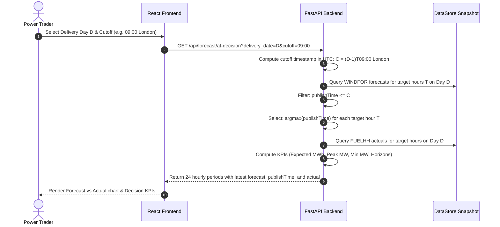

# System Architecture & Design Decisions

This document details the architectural design, data pipelines, leak-prevention mechanisms, and deployment topology for the UK Wind Generation Decision Support platform.

## 1. System Context & Overview

## 2. Leak-Free Decision Logic

## 3. Technology Stack & Directory Structure
- **Backend:** Python 3.12, FastAPI, Pydantic v2, pytest, ruff, mypy.
- **Frontend:** React 18, Vite, TypeScript, TanStack Query v5, Recharts, Tailwind CSS.
- **Data Store:** Compact snapshot loaded at startup into memory for sub-millisecond query responses.
- **Containerization:** Multi-stage Docker builds with non-root security.
