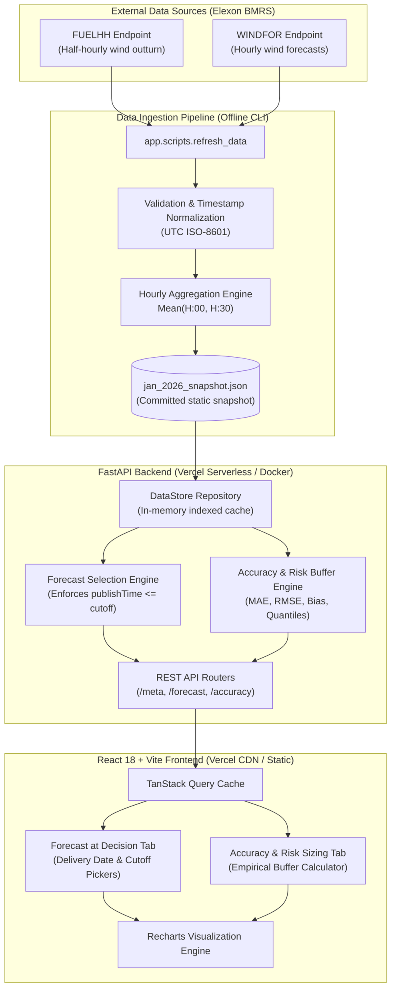
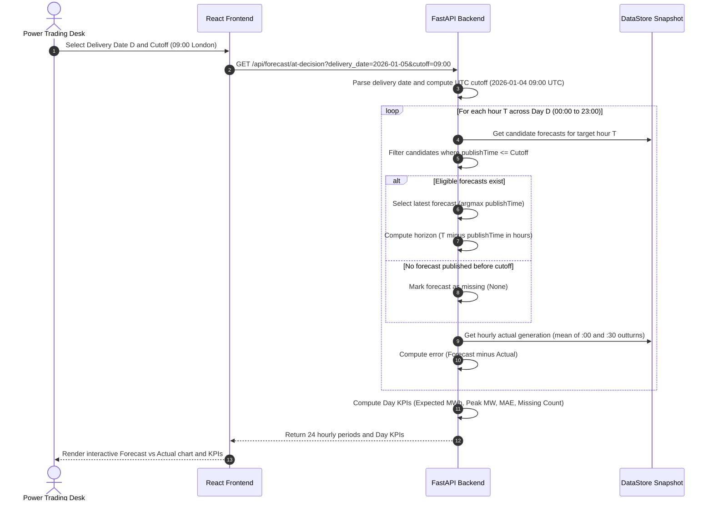

# System Architecture & Technical Design

This document details the architectural design, data pipelines, leak-prevention mechanisms, API contracts, and deployment topology for the UK Wind Generation Day-Ahead Decision Support platform.

---

## 1. High-Level System Architecture



---

## 2. Leak-Free Decision Logic Sequence

The core trading rule mandates that for any delivery day $D$, the trading desk commits purchases on day $D-1$ at the gate closure cutoff (default: `09:00 Europe/London`). Under no circumstances may a forecast published after this moment be utilized for day-ahead decisions.



---

## 3. Data Ingestion & Resolution Alignment

### Cadence Discrepancy & Solution
- **BMRS FUELHH:** Reported in 30-minute settlement periods (48 periods per day).
- **BMRS WINDFOR:** Issued in hourly resolution (`startTime` has minutes `:00`).
- **Alignment Strategy:**
  To evaluate energy delivery over the 1-hour contract block $H$, the actual generation is calculated as the arithmetic average of the two half-hour settlement periods:
  $$\text{Actual}_{\text{hourly}}(H) = \frac{\text{Actual}(H:00) + \text{Actual}(H:30)}{2}$$
  Both the individual 30-minute records (`period_00` and `period_30`) and the aggregated hourly average are preserved in the data store.

### Data Cleaning Rules
1. **Timestamp Normalization:** All timestamps converted to ISO-8601 UTC ending in `Z`.
2. **Value Validation:** Negative generation figures are rejected as telemetry corruptions.
3. **Deterministic Deduplication:** Ingestion enforces a unique key on `(publishTime, startTime)` to avoid duplicate entries during chunked queries.

---

## 4. Error Metrics & Empirical Risk Sizing Engine

### Sign Convention
$$\text{Error} = \text{Forecast} - \text{Actual}$$
- **Positive Error ($\text{Error} > 0$):** Over-forecast. Wind generation fell short of expectations; the trading desk faces physical shortfall penalties in the Balancing Mechanism.
- **Negative Error ($\text{Error} < 0$):** Under-forecast. Wind generation exceeded expectations; energy surplus.

### Mathematical Formulations
- **Mean Absolute Error (MAE):** $\text{MAE} = \frac{1}{N} \sum_{i=1}^N |\text{Forecast}_i - \text{Actual}_i|$
- **Root Mean Square Error (RMSE):** $\text{RMSE} = \sqrt{\frac{1}{N} \sum_{i=1}^N (\text{Forecast}_i - \text{Actual}_i)^2}$
- **Mean Bias Error (MBE):** $\text{MBE} = \frac{1}{N} \sum_{i=1}^N (\text{Forecast}_i - \text{Actual}_i)$
- **Safe MAPE:** Evaluated exclusively on hours where $\text{Actual}_i \ge 100\text{ MW}$ to prevent division by near-zero:
  $$\text{MAPE}_{\text{safe}} = \frac{1}{K} \sum_{\text{Actual}_i \ge 100} \frac{|\text{Forecast}_i - \text{Actual}_i|}{\text{Actual}_i} \times 100\%$$
- **Empirical Risk Buffer:**
  Given target confidence quantile $q \in [0.50, 0.99]$ and empirical over-forecast errors $\mathcal{E}^+ = \{e_i \mid e_i > 0\}$:
  $$\text{Buffer}(q) = \text{Quantile}_q(\mathcal{E}^+)$$
  $$\text{Wind}_{\text{conservative}} = \max\left(0, \text{Forecast} - \text{Buffer}(q)\right)$$
  $$\text{Thermal Procurement} = \text{Demand} - \text{Wind}_{\text{conservative}}$$

---

## 5. Deployment Architecture

### Primary Deployment Target: Vercel (Unified Serverless & CDN)
- **Frontend:** Built via Vite as an optimized static bundle and served across Vercel's global edge CDN.
- **Backend:** FastAPI exposed via `backend/api/index.py` using `@vercel/python`.
- **Zero Heavy Dependencies at Serving Time:** The API server operates in pure standard library + Pydantic v2 over the committed JSON snapshot (`backend/data/jan_2026_snapshot.json`). This keeps the serverless package under 15 MB (far below Vercel's 50 MB compressed limit) with cold starts under 150 ms.

### Container Fallback: Docker & Heroku
- **Multi-Stage Builds:** `backend/Dockerfile` and `frontend/Dockerfile` leverage multi-stage compilation and non-root users (`appuser`).
- **One-Command Orchestration:** `docker-compose.yml` mounts both services with automated healthchecks:
  ```bash
  docker compose up --build
  ```
- **Heroku Manifest:** `heroku.yml` enables containerized deployment to Heroku Dynos without buildpack configuration.
